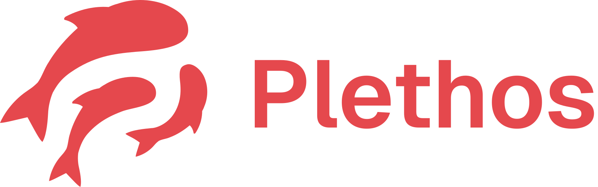
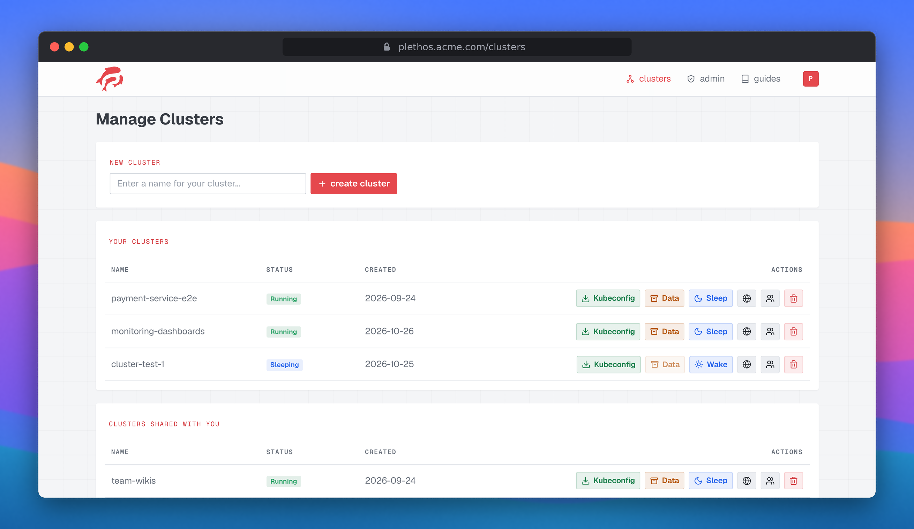
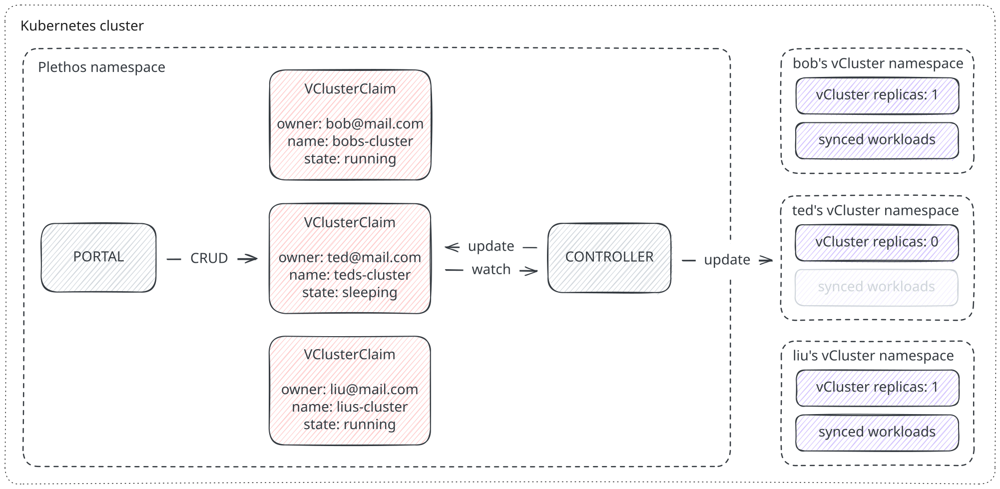

[](https://www.bestpractices.dev/projects/15131)

<p align="center">
  
</p>

*Self-service Kubernetes clusters for your organization's members and teams, provisioned as isolated [vCluster](https://www.vcluster.com/) instances.*

## 🐟 What is Plethos?
>*from Ancient Greek **πλῆθος** (plethos): a multitude, great number, crowd.*

Plethos lets members and teams of your organization provision their own Kubernetes cluster with a single click. These clusters run as virtual clusters behind the scenes. This means whoever hosts Plethos only needs a single real Kubernetes cluster and therefore avoids the operational overhead of running a separate cluster per team. Plethos uses standard OIDC, so it works with whatever your organization already runs.

<p align="center">
  
</p>

## ✨ Features

**Users can...**
- create, sleep, wake and delete their clusters
- download the kubeconfig to connect to their clusters
- export PVC/workload data
- share clusters with other users by email
- expose their deployed apps publicly

**Admins can...**
- set max-amount of clusters quota (overridable per user)
- set team-size quota (overridable per user)
- inspect cluster logs
- delete any user's clusters
- let clusters expire: clusters are put to sleep and eventually deleted, always with an emailed warning first


## ❗How it works

Plethos runs as two independent services - the **portal**, a web app members use to manage their clusters and the **controller**, a Kubernetes controller that actually provisions the vClusters. They don't talk to each other directly, instead they are connected via a Kubernetes custom resource called `VClusterClaim`.

<p align="center">
  
</p>

When a user requests a cluster, the portal creates a `VClusterClaim` object describing the desired state (owner, shared members, whether it should be running or asleep). The controller watches for changes and reconciles the real vCluster to match the `VClusterClaim`, i.e. installing it via Helm, scaling it down to sleep, waking it back up or tearing it down for deletion. It also writes the status back onto the object (its phase, readiness), which the portal reads to show the cluster's status to the user. So ownership, sharing and lifecycle all live as Kubernetes resources rather than a separate database. The Kubernetes API stays the single source of truth for both services.

## 📁 Project Structure

Plethos is a `uv` workspace of two services and a shared library:

- **portal**: a FastAPI + HTMX web app. Users authenticate via OIDC and manage their vClusters by creating, editing and deleting `VClusterClaim` custom resources.
- **controller**: a [Kopf](https://kopf.readthedocs.io/)-based Kubernetes operator that watches `VClusterClaim` resources and reconciles the actual vCluster (provisioning, sleep/wake, deletion).

Project tree:
```
├── charts/plethos/     # Helm chart to deploy Plethos
├── components/
│   ├── controller/     # KOPF k8s controller
│   ├── portal/         # FastAPI + HTMX app
│   └── shared/         # shared package
└── k8s/                # standalone k8s reference material
```

## 🚀 Getting started

**Deploying Plethos to a cluster:** see [charts/plethos/README.md](charts/plethos/README.md) for the
Helm chart, the official way to install it.

**Running it locally for development:** see [CONTRIBUTING.md](CONTRIBUTING.md#set-up) for the
full local setup (a local cluster, the CRD, a dev Keycloak instance and running both services).

## 📄 Documentation

- [components/portal/README.md](components/portal/README.md): portal setup, configuration and the cluster expiration lifecycle
- [components/controller/README.md](components/controller/README.md): controller setup, the `VClusterClaim` spec and reconciliation phases
- [charts/plethos/README.md](charts/plethos/README.md): deploying Plethos with Helm
- [k8s/README.md](k8s/README.md): standalone reference material (e.g. Velero backups)
- [adr/](adr/): architecture decision records

## ❤️ Contributing

Contributions are welcome. See [CONTRIBUTING.md](CONTRIBUTING.md) for the development workflow,
and [CODE_OF_CONDUCT.md](CODE_OF_CONDUCT.md) for community expectations.

## ⚖️ License

GNU AFFERO GENERAL PUBLIC LICENSE Version 3, see [LICENSE](LICENSE).
