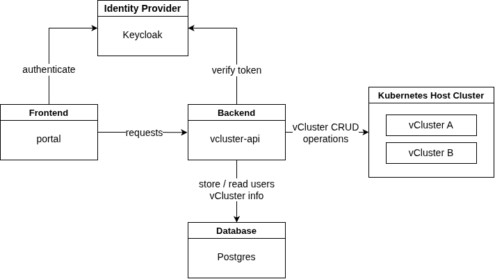

# Re-desiging the current architecture of the vCluster portal to be more minimal, easier to maintain and more K8s idiomatic.

## Context and Problem Statement

Currently, the vCluster portal has the following architecture:

As shown in the figure, there are currently four main components (next to the K8s cluster itself) that make up the platform:
- the `vcluster-api` service: This works as a proxy for delegating different vCluster CRUD operations to the Kubernetes API
- the `portal` service: A Django application which communitcated with the `vcluster-api` and serves the frontend
- a PostgreSQL database: Stores user data, vCluster data and the relationship between them
- a Keycloak instance: Used for identity management
- and the Kubernetes cluster

This vCluster management portal was developed to be deployed in a university environment where the resources and time for maintainance are slim. So even the shown architecture is quite common, it opens four different possible points of failure and a big surface for maintainance.

Therefore, the architectural design of could be simplified, to ensure to just better maintainability but also extendability. 

## Decision Drivers
* less and easier maintainance (for example by combining the `vcluster-api` and `portal`)
* be Kubernetes native/idiomatic (since it manages K8s resources, common K8s patterns should be respected)
* easy to setup (less components mean easier setup)
* open-source readiness (making the application with open-source in mind can ensure more focus on extenability and ease-of-use)

## Considered Options
**Note:** All the following options use just a single repository, since the `vcluster-api` and `portal` will be combined into a single service.

* **Namespace label defined ownership**:
    Since the current database is mainly used to map users to the vClusters they own, the ownership information could be instead stored in the K8s vCluster resources instead. The namespace, which is created per vCluster, can store the user id and other information as metadata labels to map it to their owner. Additional information about the vCluster can be stored in metadata annotations.
* **VClusterClaim CRD**:
    Again, instead of a DB, the ownership will be stored in K8s itself. This time as a Custom Resource Definition (e.g named _VClusterClaim_) which will be created for each vCluster. It stores all information necessary, such as ownership (user-id, etc.) but can also be used to store other state, like the status/phase of the vCluster, other user-id which have access. The Python service will create all resources together: The _VClusterClaim_ and all resources necessary for provisioning a vCluster.
* **VClusterClaim CRD with a custom controller**:
    This option is the same as above, but the Python service will just work with the _VClusterClaim_ CRD to define the desired state of vClusters. A K8s controller will then run in the host cluster to reconcile the desired state of all vClusters in an K8s idiomatic way.
* **PortalUser CRD**:
    This option also uses a CRD but this time one per user, not per vCluster. When a user creates a vCluster, it will be added to their _PortalUser_ resource which creates a simple ownership model. More information per vCluster can also be stored here. Though this treats the CRD more as an application data store than a K8s state store.
* **SQlite on PersistentVolumeClaim**:
    This approach is similar to the current architecture, but replaces the PostgreSQl service with a single SQLite file, which takes away a whole process. It will still store every user that logged in via SSO and map them to their owned vClusters.

## Decision Outcome

**Chosen option**: _"VClusterClaim CRD with a custom controller"_, because it represents the most K8s idiomatic way to handle vCluster resources.

### Consequences
* **Good, because** the architecture aligns with common K8s controller pattern.
* **Good, because** it gets rid of the relational database, which reduces complexity and makes the K8s API the single source of truth.
* **Good, because** the controllers reconciliation loop can automatically recover from failures and state drift.
* **Good, because** the ownership info is stored in labels, which are indexed
* **Bad, because** it still requires to maintain two different services, the portal and the controller.
* **Bad, because** application-specific data is now coupled to the K8s cluster (migrating to another storage model in the future becomes more difficult).

### Confirmation
* PostgreSql has been completely removed and all vCluster ownership and lifecycle information is stored in k8s _VClusterClaim_ resources.
* The portal service interacts exclusively with the K8s API and _VClusterClaim_ resources, without maintaining a separate application state store.
* A dedicated controller reconciles _VClusterClaim_ resources and is responsible for provisioning, updating and deleting vClusters according to the desired state.
* Creating, updating, and deleting a _VClusterClaim_ results in the expected changes to the corresponding vCluster resources without manual intervention.
* The complete platform can be deployed with only the portal application, the controller and the K8s cluster as required components.
* Keycloak does not store any application relevant data and can be switched out why a variety of other OCID IdPs (basically not considered a component of the overall architecture anymore).
* End-to-end tests validate the complete lifecycle of a vCluster through the _VClusterClaim_ API.

## Pros and Cons of the other Options

### Namespace Annotation defined ownership
* Good, because of its simplicity
* Good, because everything is within a single executable
* Good, because the ownership info is stored in labels, which are indexed
* Good, because ownership dies with the namespace
* Bad, because it misuses the namespace metadata
* Bad, because there can be no typed schema of custom state (vCluster phase, access rules, etc.) stored in the namespace.

### VClusterClaim CRD
* Good, because just a single service/process is needed
* Good, because the schema of the CRD data can be typed
* Good, because the ownership info is stored in labels, which are indexed
* Bad, because there is no drift handling, nothing reconciles the desired state of vCluster resources
* Bad, because the managing of resources like this is not K8s idiomatic

### PortalUser CRD
* Good, because this allows for a convenient overview and management of users
* Bad, because this misuses K8s as an application data store
* Bad, because there is no drift handling, nothing reconciles the desired state of vCluster resources
    -> but controller could be added

## SQLite on PersistentVolumeClaim
* Good, because a proper relation between users and their vClusters can be modelled
* Good, because of proper indices, no full scans
* Good, because this allows for a convenient overview and management of users
* Bad, because there is no drift handling, DB and K8s can diverge
* Bad, because it again uses external state that needs to be managed

<!-- This is an optional element. Feel free to remove. 
## More Information

{You might want to provide additional evidence/confidence for the decision outcome here and/or document the team agreement on the decision and/or define when/how this decision the decision should be realized and if/when it should be re-visited. Links to other decisions and resources might appear here as well.}
-->